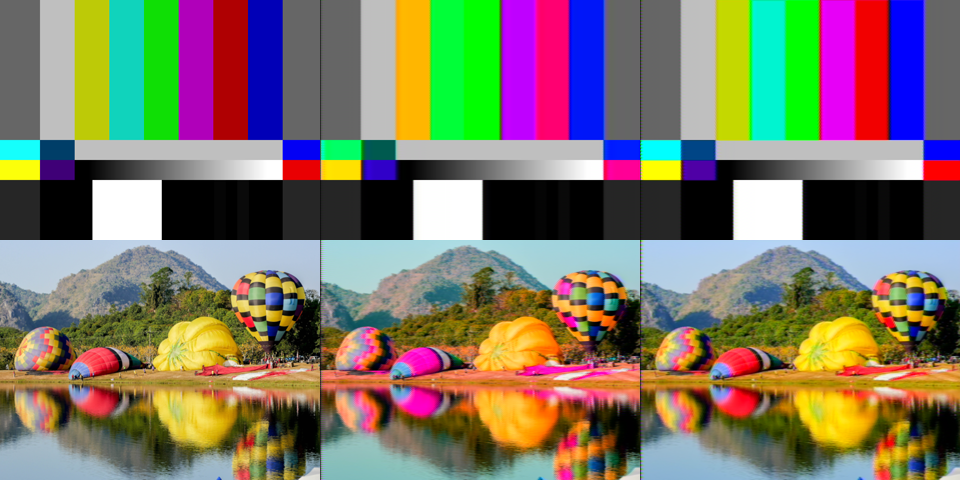

    <a href="https://ntsc.rs">
        <picture>
            <source media="(prefers-color-scheme: dark)" srcset="./docs/img/logo-darkmode.svg">
            
        </picture>
    </a>

---

**ntsc-rs** is a video effect which emulates NTSC and VHS video artifacts. It can be used as an After Effects, Premiere, or OpenFX plugin, or as a standalone application.

## PAL support (this fork)

This is a fork of [valadaptive/ntsc-rs](https://github.com/valadaptive/ntsc-rs) that adds a **PAL** mode. ntsc-rs
emulates NTSC: YIQ color on a 3.58 MHz subcarrier whose phase flips on every line. Most of Europe, Russia, Australia
and large parts of Asia, Africa and South America recorded their tapes in PAL, which carries color differently — and
breaks differently: a hue error doesn't tint a PAL picture, it cancels out into a loss of saturation.

The new **Video standard** setting (at the top of the settings list) switches the composite signal to PAL:

- **YUV instead of YIQ.** The V-switch flips exactly the V component, so for the duration of the effect the I and Q
  planes are rotated into U and V (YIQ is YUV rotated by 33°) and back at the end.
- **4.43361875 MHz subcarrier.** Every filter that is specified in MHz (chroma bandwidth, VHS tape speeds, composite
  pre-emphasis) is computed against PAL's sample rate, 4 × fsc, so the cutoffs keep their real-world meaning. One pixel
  is still a quarter of a subcarrier cycle, as in NTSC mode.
- **Phase per line.** PAL has 283.75 subcarrier cycles per line, so the phase advances by 270° per line instead of
  flipping by 180°.
- **The V-switch** — the "phase alternating line": the V carrier is inverted on every other line, and the decoder
  inverts it back.
- **The PAL delay line** (*PAL delay line* setting, on by default): the decoder averages the chroma of each line with
  the previous one. A phase error rotates the hue one way on one line and the other way on the next, so the average
  keeps the hue and loses a little saturation — the reason PAL TVs need no hue knob. This also cancels the small hue
  shift that the composite filters themselves cause. Turn it off to emulate a simple decoder (PAL-S): phase errors then
  show up as Hanover bars.
- **Bandwidth.** U and V both get 1.3 MHz (NTSC: I 1.3 MHz, Q 0.6 MHz).
- **Comb filters** compare lines two apart, where both the U and V carriers are inverted. The 2D filters are designed
  around NTSC's line-alternating carrier and fall back to the two-line comb in PAL mode.
- *Scale with video size* takes 576 lines as the reference instead of 480.

*Original / NTSC with an 18° chroma phase error (hue shift) / PAL with the same error (hue kept, slightly less
saturated).*

*PAL with an 18° phase error: without the delay line every other line is rotated the other way (Hanover bars), with it
the color is right.*

Random *chroma phase noise* is independent from one line to the next, so the delay line can only average it (√2 less
hue noise, plus some saturation flicker), as on real PAL tapes; constant or slowly varying errors cancel.

Presets made with upstream ntsc-rs load unchanged and stay NTSC; the two new settings are saved as `video_standard`
and `pal_delay_line`. There are no prebuilt binaries of this fork yet — build it from source as described in
[MAINTAINING.md](./MAINTAINING.md) (on macOS: `brew install rust gstreamer`, then
`cargo run --release --bin ntsc-rs-standalone`).

The PAL model comes from the VHS emulation of [uvcdv-capture](https://github.com/boris-timofeenko/uvcdv-capture), a
MiniDV capture tool for macOS whose `--vhs` mode is a C port of the ntsc-rs signal model adapted to PAL.

## Download and Install

The latest version of ntsc-rs can be downloaded from [the releases page](https://github.com/valadaptive/ntsc-rs/releases).

After downloading, [read the documentation for how to run it](https://ntsc.rs/docs/standalone-installation/). In particular, ntsc-rs will not work properly on Linux unless you install all of the GStreamer packages listed in the documentation.

## More information

ntsc-rs is a rough Rust port of [ntscqt](https://github.com/JargeZ/ntscqt), a PyQt-based GUI for [ntsc](https://github.com/zhuker/ntsc), itself a Python port of [composite-video-simulator](https://github.com/joncampbell123/composite-video-simulator). Reimplementing the image processing in multithreaded Rust allows it to run at (mostly) real-time speeds.

It's not an exact port--some processing passes have visibly different results, and some new ones have been added.
